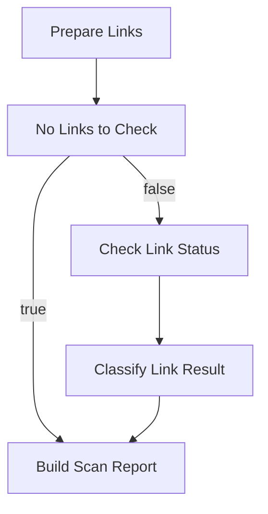

# AI-Assisted Website Scanner

A local website audit prototype using n8n, Ollama, and JavaScript. It combines HTML presence checks, a local AI summary, and HTTP checks for a small sample of links.

**Current milestone: v2.** This is a development prototype, not a complete website audit or an automated repair service. The configured demonstration target is [Books to Scrape](https://books.toscrape.com/).

## Features

- Extracts the page title, body text, meta description, H1 headings, and links from fetched HTML.
- Checks for nonempty titles, descriptions, and H1 headings using JavaScript rules.
- Generates a structured page summary using Ollama. The model receives page content rather than scanner check metadata.
- Resolves relative and absolute URLs with Node's URL parser, removes fragments and duplicates, and selects up to five HTTP(S) links on the same origin.
- Routes pages with no eligible links directly to a report marked `not_checked`.
- Classifies HTTP responses and continues after failed link requests, marking them `unverified`.
- Produces one JSON report with evidence, timestamps, coverage limits, and link counts.

The AI describes the supplied content; deterministic code generates check results. This project uses an existing model and does not train a custom model.

## Repository files

- `workflows/website-scanner-v1.json`: original demo milestone, restricted to selected Books to Scrape paths.
- `workflows/website-scanner-v2.json`: current workflow with URL parsing, empty-link branching, and link-request error handling.

## Local setup

The tested environment is Windows, Docker Desktop, n8n **2.42.7**, and Ollama on the host computer. n8n's data is stored in the persistent `n8n_data` volume mounted at `/home/node/.n8n`.

1. Start Ollama with `qwen3:4b` available. The tested model supports thinking and structured output; this workflow sends `think: true`.
2. Start n8n with the built-in `url` module allowed: `NODE_FUNCTION_ALLOW_BUILTIN=url`. In this tested internal-runner setup, the variable is on the n8n container. External runners require their own module configuration. Changing a container's environment requires recreating it while retaining its data volume; restarting alone does not add the setting.
3. Open your local n8n editor and import `workflows/website-scanner-v2.json` into a new workflow.
4. Check **Analyse Page**: its endpoint is `http://host.docker.internal:11434/api/chat`, connecting Docker to Ollama on the host. Other deployments may require a different address.
5. Keep **Scan Settings** at `https://books.toscrape.com/` for the initial verification.
6. Execute the workflow and inspect **Build Scan Report**.

Keep node names aligned with their JavaScript references. No paid AI API key is used. Hardware, electricity, and connectivity remain necessary.

Relevant documentation: [module access](https://docs.n8n.io/hosting/configuration/configuration-examples/modules-in-code-node/) and [task runners](https://docs.n8n.io/hosting/configuration/task-runners/).

## Workflow design

The initial sequence fetches and extracts the page, checks its basic elements, and requests and parses the AI summary. **Prepare Links** then selects the link sample.

## Result interpretation

| Result | Meaning |
| --- | --- |
| Page check `pass` | A nonempty element was found in fetched HTML |
| Page check `needs_review` | The expected nonempty element was not found |
| Link `pass` | HTTP response was 2xx |
| Link `broken` | HTTP response was 404 or 410 |
| Link `unverified` | Request failed, no status was available, access was denied, or rate limiting occurred |
| Link `needs_review` | Other response, such as a server error |
| Summary `not_checked` | No eligible links were selected |
| Summary `completed` | The selected requests were processed; this can include failures |

The `checked` count records attempted links, including unverified attempts. Neither a 2xx response nor a `completed` summary proves that a whole website is healthy.

## Manual validation

Observed in the development environment:

- Five selected links returned 200 and produced five passes.
- A deliberately nonexistent path returned 404 and was labelled `broken`.
- A simulated empty link list followed the true branch and produced a report with zero checks and `not_checked`.
- One temporary `.invalid` URL produced an `unverified` result while four normal requests passed; the failing URL remained correctly associated with its result.
- Temporary input overrides were removed after testing. The export contains normal link extraction and no injected network-test address.
- The AI summary improved after scanner metadata was removed from its input and the prompt was narrowed to content description.

The link timeout is configured to 15,000 ms, but a deliberate timeout has not been separately tested. These are manual checks, not a comprehensive automated test suite.

The shared export was checked for JSON validity, node references, branch routing, error configuration, and leftover test injections. Instance-specific metadata was removed and a leading tab was trimmed from the Ollama endpoint. The cleaned export has not yet been re-imported and executed.

## Known limitations

- Only one page and up to five eligible same-origin links are inspected; no recursive crawling.
- Relative URLs are resolved against the requested URL. Redirected source pages and HTML `<base>` elements are not yet handled correctly.
- Same-origin selection applies before requests; HTTP redirects can lead elsewhere.
- The initial page fetch and Ollama call can still stop the workflow. Fetch errors are not gated before HTML extraction, so an error page could be analysed as page content.
- JavaScript is not rendered. Page presence checks do not prove visual quality, accessibility, performance, or working forms and bookings.
- AI summaries may be inaccurate. Prompts reduce unsupported claims but do not guarantee correctness or prevent every prompt-injection attempt.
- No persistent scan history, dashboard, scheduling, client authentication, or automated fixes yet.
- This remains a local prototype, not a public URL-submission service. Input validation, network restrictions, and redirect handling are required before public deployment.
- The report's scope text still says “homepage”; the intended demo scans the homepage, but the configuration can accept other page URLs.

## Next milestones

1. Initial fetch validation and graceful AI/fetch failures.
2. Correct handling of redirects and HTML base URLs.
3. Saved scan history and issue tracking.
4. Dashboard with open, in-progress, resolved, and unverified findings.
5. Human-reviewed remediation suggestions and verification through rescans.

## Sharing and updates

n8n edits are not automatically synchronized to GitHub. Export each milestone, review it for secrets or private data, and commit the reviewed workflow and documentation.

This export contains no configured credentials or pinned execution data. Future exports must be reviewed again. Keep local n8n backups outside the repository: they may include account data and encryption keys. `.gitignore` cannot remove secrets embedded in tracked workflow JSON.

No project license has been selected. Dependencies retain their own licenses.
